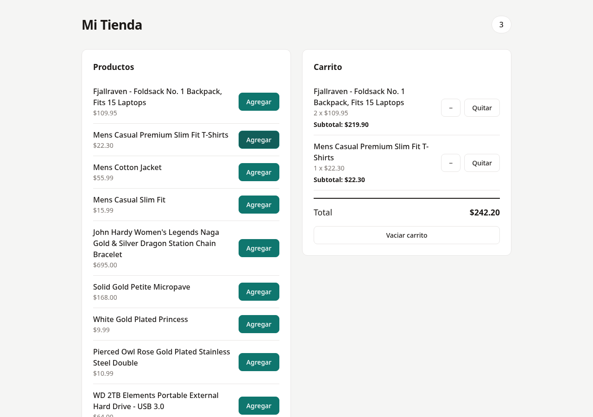

# Mi Tienda — Carrito de compras con React y Zustand

Práctica de estado global basada en la guía **“Carrito de compras con React y Zustand”**. La aplicación muestra un catálogo, permite agregar productos a un carrito compartido y calcula cantidades, subtotales y total.

El carrito vive en un store de Zustand. `Encabezado`, `ListaProductos` y `Carrito` leen y modifican ese store directamente, sin recibir props entre ellos y sin usar un `Provider`.

## Requisitos

- Node.js 20.19 o superior (o 22.12+). La guía indica 18+, pero la versión actual de Vite generada requiere Node 20.19+/22.12+. En este equipo se verificó con Node.js 24.
- pnpm.

## Instalación y ejecución

```bash
pnpm install
pnpm dev
```

Vite mostrará la dirección del servidor, normalmente `http://localhost:5173`.

## Estructura

```txt
Zutand/
├── docs/
│   └── captura.png
├── public/
│   └── favicon.svg
├── src/
│   ├── data/
│   │   └── productos.js
│   ├── store/
│   │   └── useCarritoStore.js
│   ├── components/
│   │   ├── Encabezado.jsx
│   │   ├── ListaProductos.jsx
│   │   └── Carrito.jsx
│   ├── App.jsx
│   ├── index.css
│   └── main.jsx
├── index.html
├── package.json
└── pnpm-lock.yaml
```

La separación de responsabilidades es la siguiente:

- **`data/`**: obtiene y adapta los datos de la tienda.
- **`store/`**: concentra el estado del carrito y las acciones que lo modifican.
- **`components/`**: contiene únicamente la vista y las interacciones.

## Cómo funciona

### Datos desde la API

`src/data/productos.js` consulta `https://fakestoreapi.com/products` con `fetch` y adapta las propiedades de la API:

| API Fake Store | Store y componentes |
| --- | --- |
| `id` | `id` |
| `title` | `nombre` |
| `price` | `precio` |

La petición se ejecuta dentro de un `useEffect` en `ListaProductos`, con `AbortController` para cancelarla si el componente se desmonta. El componente muestra un mensaje mientras carga y otro si la petición falla.

> Fake Store API devuelve los precios en dólares estadounidenses (USD). Por eso se muestran con formato de moneda USD y no se convierten a pesos colombianos.

### Store

`src/store/useCarritoStore.js` contiene:

- `items`: arreglo con los productos del carrito. Cada producto guarda `id`, `nombre`, `precio` y `cantidad`.
- `agregarProducto(producto)`: agrega el producto con cantidad `1` o incrementa la cantidad si el `id` ya existe.
- `disminuirCantidad(id)`: resta una unidad y elimina el producto cuando la cantidad llega a `0`.
- `eliminarProducto(id)`: quita el producto completo.
- `vaciarCarrito()`: deja `items` en un arreglo vacío.

Todas las actualizaciones crean arreglos nuevos con `map`, `filter` y el operador spread; nunca se modifica el arreglo original con `push` ni asignaciones directas.

### Componentes

- **`Encabezado`**: lee `items`, suma las cantidades con `reduce` y muestra el total de unidades en la insignia.
- **`ListaProductos`**: carga el catálogo desde la API, muestra nombre y precio, y ejecuta `agregarProducto` al hacer clic.
- **`Carrito`**: muestra cada producto con su cantidad, precio unitario y subtotal; calcula el total general y permite disminuir, quitar o vaciar.
- **`App`**: organiza el encabezado y los dos paneles. No pasa props ni envuelve la aplicación en un `Provider`.

## Retos implementados

### 1. Disminuir cantidad

Se agregó la acción `disminuirCantidad(id)`. El botón `−` resta una unidad y, si la cantidad queda en `0`, el producto se elimina del carrito mediante `filter`.

### 2. Subtotal por producto

Cada fila del carrito muestra:

```txt
2 x $109.95
Subtotal: $219.90
```

El subtotal se calcula como `item.precio * item.cantidad` y el total general suma todos los subtotales.

### 3. Carrito persistente

El store está envuelto con el middleware `persist` de Zustand:

```js
persist(..., {
  name: 'carrito-zustand',
  partialize: (state) => ({ items: state.items }),
})
```

El carrito se guarda en `localStorage` con la clave `carrito-zustand` y se recupera al recargar la página. `partialize` guarda únicamente `items`, no las funciones del store.

### 4. Productos desde una API

Se reemplazó el arreglo local de `productos.js` por la función `obtenerProductos()`, que consulta Fake Store API y adapta `title` y `price` a `nombre` y `precio`. Se añadieron estados de carga y error para la petición.

## Preguntas de reflexión

### 1. ¿Por qué `Encabezado` se actualiza cuando agregas un producto, si no recibe ninguna prop?

Porque `Encabezado` no depende de props: se suscribe directamente al store con `useCarritoStore((state) => state.items)`. Cuando una acción modifica `items`, Zustand notifica a todos los componentes suscritos y React vuelve a renderizar `Encabezado`, aunque `App` no le haya pasado nada.

### 2. ¿Qué tendrías que hacer para lograr lo mismo usando solo `useState` en `App`?

Tendría que subir el estado del carrito a `App` con `useState`. Luego pasaría `items` y las funciones que lo modifican como props a `Encabezado`, `ListaProductos` y `Carrito`. Eso obliga a pasar props por varios niveles (prop drilling) y hace que los cambios de estado en `App` puedan volver a renderizar componentes que no los necesitan.

### 3. ¿Para qué sirve el selector `(state) => state.items` al usar el hook?

El selector indica qué parte del store necesita el componente. Así el componente se suscribe a `items` y no a todo el estado; se vuelve a renderizar cuando cambia esa porción. También deja explícita la dependencia y evita re-renderizados innecesarios cuando cambian otras propiedades del store.

### 4. ¿Por qué en el store se crean arreglos nuevos con `map` y `filter` en lugar de modificar `items` directamente?

Porque React y Zustand detectan los cambios comparando referencias. Si se muta el arreglo original con `push` o asignaciones directas, la referencia sigue siendo la misma y la interfaz puede no actualizarse. Al crear un arreglo nuevo con `map`, `filter` o spread, la referencia cambia, el estado es predecible y se evitan efectos secundarios sobre el estado anterior.

### 5. ¿Zustand es parte de React? Explica la diferencia entre una librería propia de React y una del ecosistema.

No. Zustand es una librería externa del ecosistema de React: se instala aparte con `pnpm add zustand` y no viene incluida en el paquete `react`. React proporciona sus propias herramientas de estado, como `useState`, `useReducer` y `Context`; Zustand es una alternativa de terceros que se integra con React para manejar estado global.

## Pruebas realizadas

- [x] Al cargar, el carrito muestra “Tu carrito está vacío” y la insignia muestra `0`.
- [x] Al agregar un producto, aparece en el carrito y la insignia sube a `1`.
- [x] Al agregar otra vez el mismo producto, no se duplica la fila: la cantidad pasa a `2`.
- [x] El total se recalcula con cada producto agregado.
- [x] El botón `−` resta una unidad y elimina el producto al llegar a `0`.
- [x] Cada fila muestra su subtotal.
- [x] El botón `Quitar` elimina solo ese producto.
- [x] El botón `Vaciar carrito` deja la insignia en `0` y muestra el mensaje de vacío.
- [x] El carrito se conserva después de recargar la página.
- [x] En una pantalla angosta, los paneles se ubican uno debajo del otro.

## Captura



## Notas

- La captura se generó con un navegador headless y la aplicación en ejecución.
- El proyecto usa pnpm como gestor de paquetes.
- El script `build` de la plantilla se conserva en `package.json`, pero no forma parte del flujo de ejecución de esta práctica.
